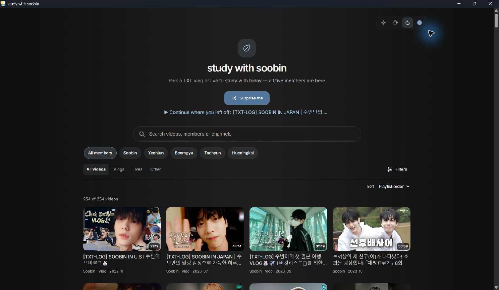
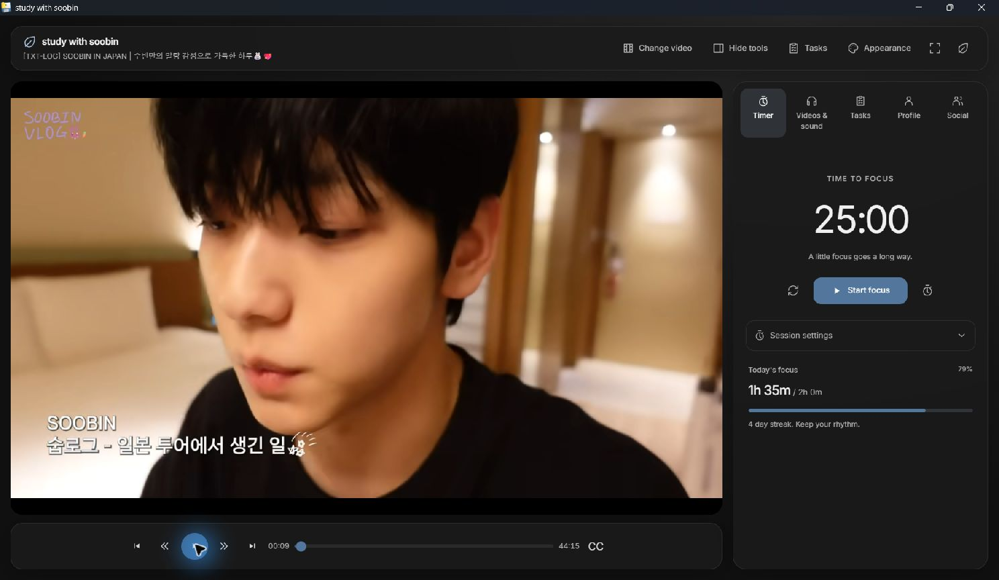
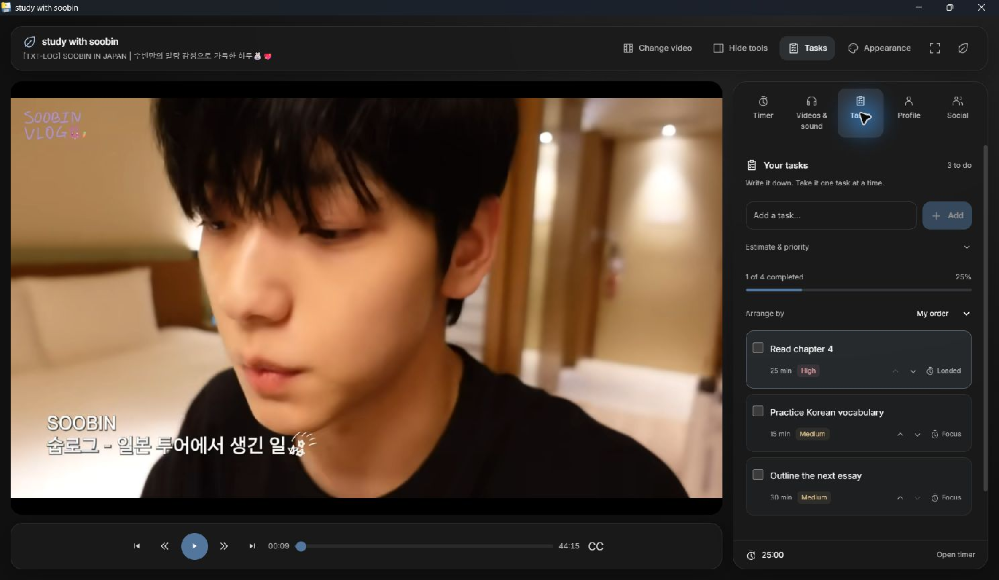
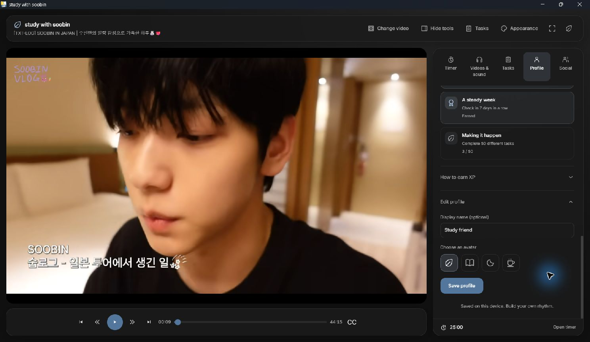
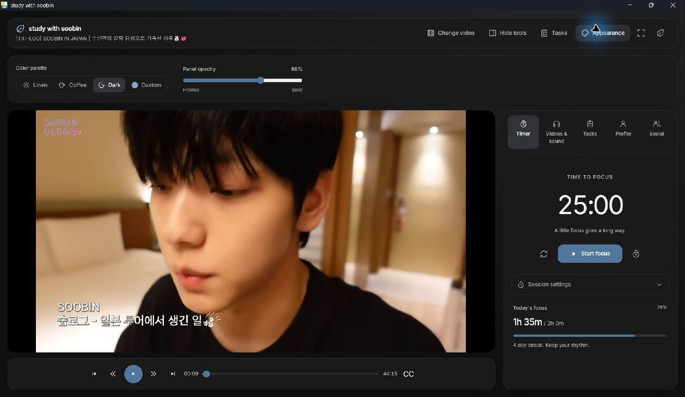
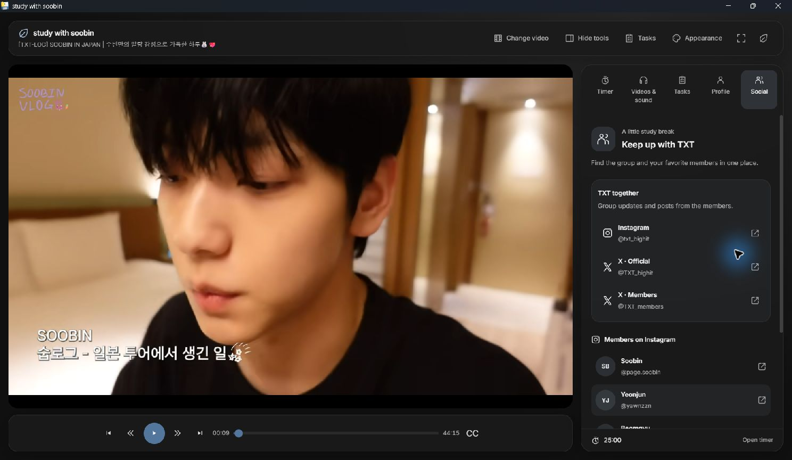

# Screenshots and feature walkthrough

Screenshot assets live in `docs/images/`. New captures should use an isolated
demo profile with example tasks, so personal study data does not appear in
documentation. Capture the running app, including real playback when available.

## Main features to demonstrate

1. **Video discovery:** search, member chips, type/date filters, and thumbnails.
2. **Focus timer:** video playback beside the timer and expanded session settings.
3. **Tasks:** a populated checklist with unfinished and completed work.
4. **Profile:** XP, next-level progress, lifetime hours, and milestones.
5. **Appearance:** palette choices and the frosted-to-solid opacity control.

## Current dark-mode screenshots

Captured October 18, 2026 from the Windows app with the neutral charcoal Dark
preset and an isolated demo profile. The workspace uses actual YouTube playback,
paused for consistent captures. The example tasks and progress are demo data.
Profile settings and progression are available only in the **Profile** tools tab;
the home screen and toolbar keep their focus on choosing and studying with a video.

### Video discovery

Search, member and video-type filters share the dark palette.

### Study workspace

The timer and playback controls sit beside and below the reserved video stage.

### Tasks

The checklist shows priorities, estimates, progress, and the loaded focus task.
[Completed work](images/dark-completed-tasks.jpg) remains available in its disclosure.

### Profile and study hours

The demo profile shows Level 5, XP toward the next level, and 12 hours 35 minutes
studied. [Study hours and milestones](images/dark-study-hours.jpg) share the same
neutral surfaces and readable text.

Open **Edit profile** within the tab to change the display name and avatar.

### Appearance

The renamed Dark preset and saved panel-opacity control appear inline.

### Social

Group and member account links appear in the Social tab.

## Earlier reference images

These images predate the current appearance and profile features. They are kept
as historical references, rather than presented as screenshots of the new UI.

### Video catalog

### Study workspace

