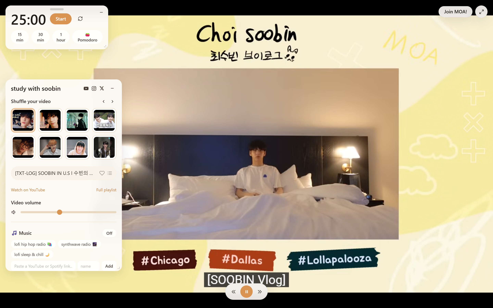

# Screenshots and feature walkthrough

Screenshot assets live in `docs/images/`. New captures should use an isolated
demo profile with example tasks, so personal study data does not appear in
documentation. Capture the running app, including real playback when available.

## Main features to demonstrate

1. **Video discovery:** search, member chips, type/date filters, and thumbnails.
2. **Focus timer:** video playback beside the timer and expanded session settings.
3. **Tasks:** a populated checklist with unfinished and completed work.
4. **Profile:** XP, next-level progress, lifetime hours, and milestones.
5. **Appearance:** palette choices and the frosted-to-solid opacity control.

## Earlier reference images

These images predate the current appearance and profile features. They are kept
as historical references, rather than presented as screenshots of the new UI.

### Video catalog

### Study workspace

